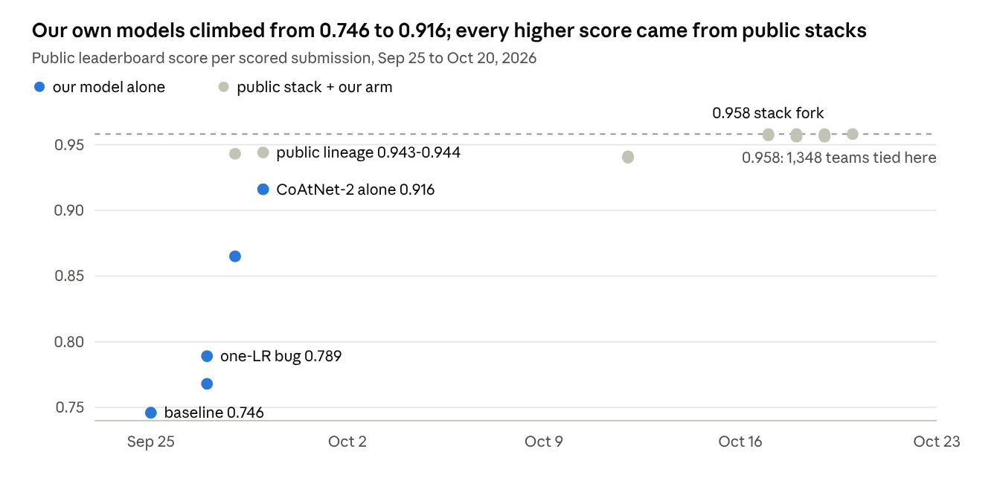
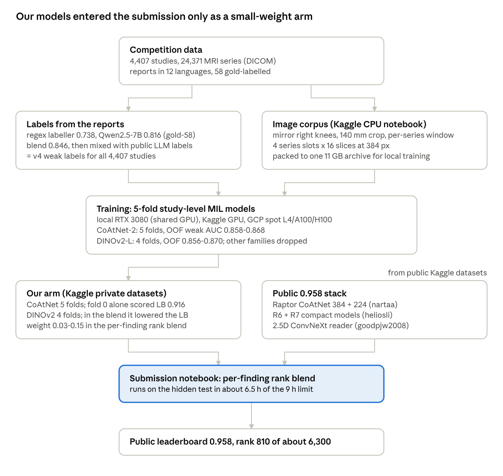

# RSNA Knee: what we built, what went wrong, what to keep

Team `_the_name _is_NERD`, [RSNA Knee Abnormality Detection](https://www.kaggle.com/competitions/rsna-knee-abnormality-detection), written Oct 21, 2026 (before the private leaderboard).

**What is not in this repository or its releases:** every gold label column and all report text are left out. Both are competition data; get them from the competition itself.

## Summary

We finish at public 0.958, rank 810 of about 6,300 (top 13%), tied with 1,348 teams; bronze needed roughly rank 624. Our own best model scored 0.916 alone, while the public models we blended with score about 0.945-0.955 each, so every score we earned came from the public stack, not from our models.

We spent most of the four weeks building our own models from report-derived labels. They improved steadily (0.746 to 0.916 on the leaderboard) but never got close enough to the public models to lift a 0.958 ensemble. Ten blend submissions in the last week scored 0.958 or lower.

Three lessons carry the rest of this report:

- **Start from the strongest public pipeline on day one.** The public models used outside data (OAI, fastMRI) and better labels that we never matched.
- **Our validation could not see what mattered.** It measured our models alone, never how they behave inside the public stack, so it pointed us the wrong way (DINOv2).
- **Paid compute needs leaderboard evidence first.** Cloud GPU time bought models that the leaderboard later showed could not help.

## Timeline

Our own models improved by 0.17 in four days (Sep 25-29), then stalled at 0.916; from Sep 28 every best score came from forking public stacks, first at 0.943, then at 0.958 from Oct 17.

1. **Sep 22-25: labels.** Regex labeller (0.738 on gold-58), then a Qwen2.5-7B labeller; the blend reaches 0.846.
2. **Sep 25-29: our own models.** ResNet34 baseline, DINOv3 with a learning-rate bug, then the corpus rebuild (laterality, physical crop, per-series window) and CoAtNet-2 at 0.916.
3. **Sep 28-Oct 12: first public lineage (0.943).** Our CoAtNet arm added 0.001 at weight 0.20 and cost 0.003-0.004 at 0.30-0.40.
4. **Oct 2-19: more folds and families.** CoAtNet folds on a local GPU, then CoAtNet folds 2-4, EfficientNetV2-M and DINOv2-L on GCP spot GPUs.
5. **Oct 17-20: the 0.958 stack.** Ten variants with our arm or R7; none moved off 0.958, two DINOv2 blends fell to 0.956-0.957.

## Architectures tried

CoAtNet-2 was our best model (0.916 on the leaderboard alone, out-of-fold weak AUC 0.858-0.868); nothing we trained came within 0.03 of the public models. All models share one study-level design: each series is encoded slice by slice, slices and series are pooled with attention (multiple-instance learning), and 12 sigmoid heads output the findings.

| Model | Input | Labels | Trained on | Our validation | Leaderboard | Verdict |
| --- | --- | --- | --- | --- | --- | --- |
| ResNet34, 3 folds | 256 px mosaics | regex | Kaggle GPU | weak 0.780, gold 0.776 | 0.746 (Sep 25) | Baseline; superseded |
| ResNet34, 5 folds | 384 px | regex + LLM blend | local + Kaggle | not recorded | 0.768 (Sep 27) | Superseded |
| DINOv3 ConvNeXt-tiny, fold 0, one learning rate | 384 px | regex + LLM blend | local RTX 3080 | weak AUC fell 0.660 to 0.540 | 0.789 (Sep 27) | Bug: learning rate destroyed the backbone |
| DINOv3 ConvNeXt-tiny, fold 0, split learning rate | 384 px | regex + LLM blend | local | not recorded | 0.865 (Sep 28) | Fixed, but weaker than CoAtNet |
| CoAtNet-2 (`coatnet_rmlp_2_rw_384`), fold 0 | 384 px, 140 mm crop, laterality mirrored, per-series window | v4 blend | local | weak 0.863 | **0.916** (Sep 29) | Our best model |
| CoAtNet-2, 5 folds | same | v4 blend | local (folds 0-1), GCP (folds 2-4) | weak 0.858-0.868 | not submitted alone | Best family; kept |
| CoAtNet-2, compartment ROI views (fold 0) | coronal/axial split into medial and lateral halves | v4 blend | local | weak 0.842 (vs 0.863 without) | not submitted | Worse; dropped |
| EfficientNetV2-M | 384 px | v4 blend | GCP | no result kept | not submitted | Paid for, nothing survived |
| DINOv2 ViT-L, 4 folds (0, 1, 2, 4) | 384 px | v4 blend | GCP A100/H100 | weak 0.856-0.870 | blends only: 0.956-0.957 | Helps our arm, hurts the stack |

"Weak" AUC is measured against report-derived labels on about 880 held-out studies per fold; "gold" against the 58 hand-labelled studies, which is too small to separate models (its 95% interval is about plus or minus 0.16).

On the 1,763 studies where both families were scored, a 50/50 rank blend of CoAtNet and DINOv2 reached weak AUC 0.870, versus 0.863 for CoAtNet alone. Inference precision (fp16 or fp32) changed nothing (AUC identical to four decimals; fp32 about 3x slower).

### Public models we blended with

The 0.958 stack (goodpjw2008, version 25) combines four public model groups by per-finding rank averaging:

| Component | What it is | Score alone |
| --- | --- | --- |
| Raptor CoAtNet 384 (nartaa) | CoAtNet MIL, 96 slices, trained on all data plus OAI | 0.949 |
| Raptor CoAtNet 224 (nartaa) | same weights family, 0.8 centre crop | 0.945 |
| R6 compact (heliosli) | ConvNeXt, 4 folds, flip TTA, fluid and Baker's stackers | 0.957 blended with Raptor |
| 2.5D ConvNeXt reader (goodpjw2008) | 3 folds, at 1/10 weight | not reported |
| R7 compact (heliosli), our last addition | ConvNeXt-small, fastMRI auxiliary training | 0.956 blended with Raptor |

## How the pieces connected

Two branches fed training: labels read from the reports, and an image corpus built on Kaggle and trained on locally or in the cloud. At submission time our checkpoints were only a small-weight arm next to the public stack.

Every leaderboard point above 0.916 came from the right-hand branch; our arm moved the blend by less than 0.001 or lowered it.

## Our mistakes

The costliest mistake was strategic: we built our own models for three weeks instead of starting from the strongest public pipeline, and paid for cloud GPU time that produced models which could not lift it. The rest are ordered by what they cost.

| # | Mistake | What it cost | Do instead |
| --- | --- | --- | --- |
| 1 | Built our own pipeline from scratch; joined the public 0.958 stack only on Oct 17 | Most of four weeks; our best model ended 0.04 below the public ones | Fork the best public notebook on day one, then look for what it lacks |
| 2 | Gated cloud spend on beating our own CoAtNet in validation, and let an overnight GCP queue run unchecked | About 34 GPU-hours, no leaderboard gain | Gate paid compute on a leaderboard result; quote GPU-hours x price before each job |
| 3 | Trusted out-of-fold AUC of our arm alone to choose blends | DINOv2 blend recommended, scored 0.956-0.957 against 0.958 | Validate the blend that is submitted; without the stack's own OOF, treat our OOF as a proposal only |
| 4 | No laterality normalisation in the first corpus | Medial/lateral meniscus and OA targets unlearnable for several submissions and a corpus rebuild | Mirror right knees before training; audit laterality recovery first (98.6% once fixed) |
| 5 | One learning rate for a pretrained DINOv3 backbone | Weak AUC fell to 0.54 (chance); the 0.789 submission came from a damaged encoder | Split learning rates: about 3e-5 backbone, 1e-3 head; stop if weak AUC falls in the first 3 epochs |
| 6 | Folds not grouped by report text | Validation leaked through duplicate reports; early OOF numbers were inflated | Group folds by report hash (fixed Sep 27) |
| 7 | Fold split depended on CPU sort order (AVX-512 vs Windows) | Cloud and local splits agreed on only 22% of studies; scoring on the wrong split inflated OOF by 0.03-0.04 | Save the fold assignment with every checkpoint; use a stable sort |
| 8 | Fixed pixel crop instead of a fixed physical field | Scale differed between scanners | Crop to millimetres (140 mm), fixed Sep 27 |
| 9 | VRAM cap set at 0.60, close to the working set | Epochs took 18 h instead of 2.4 h; one fold got 3 epochs in 2.5 days | Limit memory by chunk size, keep the cap as a backstop (0.75) |
| 10 | Long jobs started as session-bound tasks, from a path containing a semicolon | Three launches died with zero epochs; one broken virtualenv | Detached launcher from a semicolon-free path, resumable jobs, check the first epoch time |
| 11 | Bulk-downloaded competition data through the API | Download quota banned for about 13 h, twice | Do data work inside Kaggle notebooks; transfer one packed archive |
| 12 | Poll loop swallowed errors | Two submissions silently lost (Sep 28) | Retry each network step; check the submission list, not the kernel status |
| 13 | An API key file was dropped into the repo folder | Nearly pushed to GitHub | Broad .gitignore for keys; never keep keys next to code |

## Labelled data

We hold study-level labels for all 4,407 training studies, made by our own labellers from the radiology reports; the best reaches 0.846 macro AUC against the 58 hand-labelled (gold) studies.

| Asset | Rows | What it is | Gold-58 macro AUC | Released |
| --- | --- | --- | --- | --- |
| Regex labeller (`src/rsna_knee/reports.py`) | code | 175 regex lines, 12 languages incl. Greek and Cyrillic, graded severity, hedging, tear vs degeneration | 0.738 | code here; labels in the release |
| Qwen2.5-7B labels | 4,407 | LLM reading each report on a graded 0-3 scale | 0.816 | yes |
| Regex + Qwen blend | 4,407 | 50/50 blend; the regex breaks the LLM's ties | **0.846** | yes |
| v4 training labels | 4,407 | our blend mixed with public LLM labels from stevenleehans and pilkwang | not measured separately | no (third-party labels) |
| Out-of-fold model predictions | 9 files | CoAtNet and DINOv2 predictions on studies each fold never saw | weak 0.856-0.870 | yes |
| Gold labels and report text | 58 / 4,407 | competition data | reference | **no** |

## What we kept

| Item | Size | Where it is published |
| --- | --- | --- |
| CoAtNet-2, 5 folds (fp32) | 1.4 GB | [Hugging Face](https://huggingface.co/shivpratapsingh/rsna-knee-coatnet-dinov2) |
| DINOv2-L, 4 folds (fp32) | 4.6 GB | [Hugging Face](https://huggingface.co/shivpratapsingh/rsna-knee-coatnet-dinov2) |
| Derived labels + OOF predictions | 5 MB | [Hugging Face](https://huggingface.co/shivpratapsingh/rsna-knee-coatnet-dinov2) |
| Code: labeller, corpus builder, trainer, inference, cloud kit | | this repository (MIT) |

Dropped: ResNet and DINOv3-tiny checkpoints (superseded), the ROI variant (worse), duplicate copies and corpora built before the laterality and crop fixes.

## Next time

Next competition, spend the first week standing on the best public work and the rest finding what it lacks.

1. **Day 1: fork and submit the best public notebook.** It sets the floor and shows what the leaders use (outside data, label sources, TTA).
2. **Day 1-2: read the top notebooks and the forum for their data.** Here the gap was OAI and fastMRI pretraining plus better LLM labels, not architecture.
3. **Build validation for the thing you submit.** Out-of-fold predictions for the whole blend, not for our arm alone; if the public models were trained on all data, say so and lean on the leaderboard.
4. **Fix the data before the model.** Laterality, physical crop, per-series windowing and report-grouped folds each cost us a rebuild because they came late.
5. **Save the fold assignment with every checkpoint.** Never recompute a split on another machine.
6. **Price every paid job up front.** GPU-hours x rate, a leaderboard result as the gate, and a watcher that stops the queue when a run is not improving.
7. **Run data and heavy jobs on Kaggle first.** Its CPU budget is generous; keep the GPU hours for training and submissions.
8. **Make final picks different on purpose.** Two submissions that differ in their exact score give two chances on the private board; two copies of a public notebook tie with everyone who copied it.
